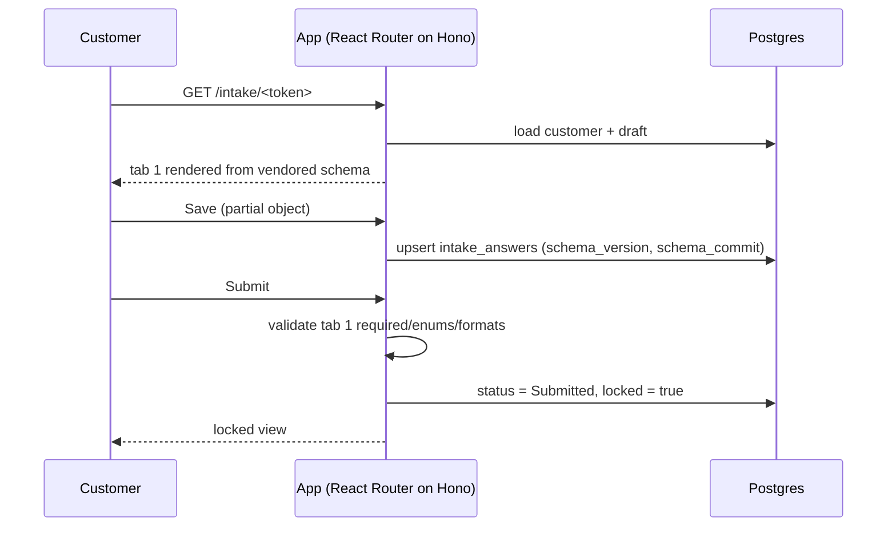

# Example dry-run output — wi-maaz20x-004-intake-company-service

Produced on 2026-10-14 with `node scripts/spec-compile.mjs wi-maaz20x-004-intake-company-service --dry-run` from the brain (simulated approval, placeholder Linear ID). Shows exactly what would be written into the project repo.

```
DRY RUN — would write into /home/jesuspoleo/Professional/Ignyte/ignyte-project-brain:

===== openspec/changes/intake-company-service/proposal.md
# Screen E tab 1 — Company & service intake generated from the Package Overview schema

> Brain work item: [[wi-maaz20x-004-intake-company-service]] · brain_commit 3fa07f4f39b0d7101468c7fa891c1a2f4e2a0f26 · ignyte-project-brain/projects/maaz20x/work-items/wi-maaz20x-004-intake-company-service.md
> Compiled by PB - Spec Compile. Do NOT edit intent here; intent changes go back to the brain (Escalation Rule).

## Why

- [[maaz20x-mvp-plan-v3-1]] §1.4–1.5, §2.12–2.13, §2.16–2.17: link without login, header with company and service, progress bar, Save/Submit, tab 1 fields, save/resume, submit locks.
- [[maaz20x-contract-package-overview-json]]: schema FRC-CSO-PKG v0.1.6, full field list with required flags, enumerations, golden example.
- [[maaz20x-fedramp-schemas-catalog]]: pinned commit `a561c28`; schemas vendored, version recorded per package.
- [[maaz20x-cr26-work-package-findings]] §2 item 4 and §3: why the old form failed (objects collapsed to rows, repeating groups by position, category shorthand, missing advisors) and the seven fault cases.
- [[maaz20x-intake-questionnaire]] §3: questions 1–5 map to this tab.
- [[maaz20x-meeting-2026-10-14-max-christina]]: the form is generated from the schema instead of hand-built (how it fits in 5 days).
- Contradiction noted: plan §2.13 says "Assessor: left empty for the customer; Ignyte fills it" — kept.

## What changes

In: the customer-facing form for every Package Overview field except `assessor` (Ignyte-only), rendered from the vendored schema; save/resume by link; submit; read-only view on Screen D (display only; JSON generation is [[wi-maaz20x-007-package-overview-json]]).
Out: tabs 2 and 3, JSON generation/validation, consultant editing of answers, multi-language, file uploads.

## Out of scope

See "Scope" in the brain spec; anything not listed there is out.

===== openspec/changes/intake-company-service/design.md
# Design — Screen E tab 1 — Company & service intake generated from the Package Overview schema

> Brain work item: [[wi-maaz20x-004-intake-company-service]] · brain_commit 3fa07f4f39b0d7101468c7fa891c1a2f4e2a0f26 · ignyte-project-brain/projects/maaz20x/work-items/wi-maaz20x-004-intake-company-service.md

## Behavior

- Opening the intake link (no login) shows the header (company name, service name from the customer record), a progress bar across the three tabs, Save and Submit.
- Tab 1 renders sections in schema order: Service identification, Service properties (incl. Trust Center, Secure Configuration Guidance, Additional repositories as **object groups**, not rows), Contacts (repeating list, add/remove row), Advisors (repeating), Certified services (repeating), Third-party resources certified / non-certified (repeating). `assessor` is hidden from the customer.
- Required fields are marked from the schema's `required` arrays. Enumerated fields are dropdowns/multi-selects with the exact schema strings.
- Save stores a draft; reopening the link shows saved answers. Submit runs validation, locks the form and sets the customer status to Submitted; Ignyte can unlock (Screen B).
- Customer status becomes In progress on first save.

## Data and fields

Field list, types and required flags: [[maaz20x-contract-package-overview-json]] §2 (not duplicated here; the form is generated from the same schema file). Storage: `intake_answers` keyed by customer and tab, JSON column holding the partial Package Overview object plus `schema_version` ("0.1.6") and `schema_commit` ("a561c28"). `serviceIdentification.fedRampPackageId`: pre-filled with provider name + acronym when empty (converter convention).

## Validation

- Client-side (Valibot, generated from the schema): required, string formats (uri, email, date), enum membership.
- `accessRequestInstructions` required when `authenticationRequired` is true (Trust Center, Secure Configuration Guidance, Additional repositories).
- Phone: free string in schema; accept as typed, no "(202) 555-0199" rejection at this tab (the fault case belongs to JSON validation on Screen D).
- Submit blocked while any required field in tab 1 is empty; Save never blocks.

## Permissions

Anyone with the link can read/write the draft until Submitted (plan §1.4, §4.2). After Submit: read-only for the link, until Ignyte unlocks. Ignyte users: read-only view on Screen D.

## Flows



## Integrations

- [[integration-maaz20x-to-fedramp-schemas-catalog]]: the form reads the vendored pinned schema; no runtime GitHub call.

## Non-functional requirements

- Form definition derives from the schema file at build time; adding a schema version must not require hand-editing fields.
- Autosave not required; explicit Save is enough for MVP.
- Accessibility: labels bound to inputs, keyboard navigable (shadcn defaults).

===== openspec/changes/intake-company-service/specs/maaz20x-intake-company-service/spec.md
## ADDED Requirements

### Requirement: Screen E tab 1 — Company & service intake generated from the Package Overview schema

The system SHALL behave as every scenario below states (brain work item [[wi-maaz20x-004-intake-company-service]] at brain_commit 3fa07f4; scope in proposal.md).

#### Scenario: the intake link is opened without a session
- **WHEN** the intake link is opened without a session
- **THEN** tab 1 renders with the customer's company and service name in the header

#### Scenario: the vendored Package Overview schema has a required field
- **WHEN** the vendored Package Overview schema has a required field
- **THEN** the form marks it required and Submit is blocked while it is empty

#### Scenario: an enumerated field is shown
- **WHEN** an enumerated field is shown
- **THEN** its options are exactly the schema strings (e.g. "Artificial Intelligence (AI)", "Government Community Cloud")

#### Scenario: Trust Center has authenticationRequired true and no accessRequestInstructions
- **WHEN** Trust Center has authenticationRequired true and no accessRequestInstructions
- **THEN** Submit shows an error on that group

#### Scenario: Save is clicked
- **WHEN** Save is clicked
- **THEN** the partial object is stored with schema_version 0.1.6 and schema_commit a561c28 and the customer status becomes In progress

#### Scenario: the link is reopened after Save
- **WHEN** the link is reopened after Save
- **THEN** every saved answer is shown

#### Scenario: Submit succeeds
- **WHEN** Submit succeeds
- **THEN** the form is read-only and the customer status is Submitted

#### Scenario: Ignyte unlocks the customer
- **WHEN** Ignyte unlocks the customer
- **THEN** the link is editable again and status returns to In progress

#### Scenario: the golden example values are entered
- **WHEN** the golden example values are entered
- **THEN** tab 1 submits with zero validation errors

===== openspec/changes/intake-company-service/tasks.md
# Tasks — Screen E tab 1 — Company & service intake generated from the Package Overview schema

> Brain work item: [[wi-maaz20x-004-intake-company-service]] · brain_commit 3fa07f4f39b0d7101468c7fa891c1a2f4e2a0f26 · ignyte-project-brain/projects/maaz20x/work-items/wi-maaz20x-004-intake-company-service.md

## 1. Setup
- [ ] 1.1 Read the frozen brain spec at brain_commit 3fa07f4; confirm nothing changed upstream (`git log -1 -- projects/maaz20x/work-items/wi-maaz20x-004-intake-company-service.md`)

## 2. Implement
- [ ] 2.1 WHEN the intake link is opened without a session THEN tab 1 renders with the customer's company and service name in the header
- [ ] 2.2 WHEN the vendored Package Overview schema has a required field THEN the form marks it required and Submit is blocked while it is empty
- [ ] 2.3 WHEN an enumerated field is shown THEN its options are exactly the schema strings (e.g. "Artificial Intelligence (AI)", "Government Community Cloud")
- [ ] 2.4 WHEN Trust Center has authenticationRequired true and no accessRequestInstructions THEN Submit shows an error on that group
- [ ] 2.5 WHEN Save is clicked THEN the partial object is stored with schema_version 0.1.6 and schema_commit a561c28 and the customer status becomes In progress
- [ ] 2.6 WHEN the link is reopened after Save THEN every saved answer is shown
- [ ] 2.7 WHEN Submit succeeds THEN the form is read-only and the customer status is Submitted
- [ ] 2.8 WHEN Ignyte unlocks the customer THEN the link is editable again and status returns to In progress
- [ ] 2.9 WHEN the golden example values are entered THEN tab 1 submits with zero validation errors

## 3. Verify
- [ ] 3.1 Automated review (PB - Review PR) against this spec
- [ ] 3.2 Human triage (gate 7) recorded in Linear 

===== back-link (Handoff Metadata Exception) — would set in brain projects/maaz20x/work-items/wi-maaz20x-004-intake-company-service.md:
  handoff.spec_artifacts: ["openspec/changes/intake-company-service/proposal.md", "openspec/changes/intake-company-service/design.md", "openspec/changes/intake-company-service/specs/maaz20x-intake-company-service/spec.md", "openspec/changes/intake-company-service/tasks.md"]
  + history line, commit "chore(handoff): link wi-maaz20x-004-intake-company-service artifacts"
```
