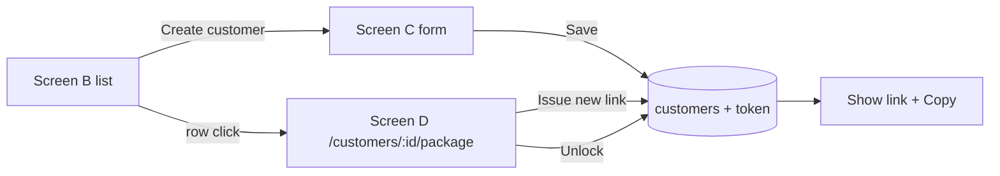

# Design — Screens B and C — customers list and create customer with intake link

> Brain work item: [[wi-maaz20x-003-customers-list-and-create]] · brain_commit a739b08ecff5ee0a226492e0951aa702516032dd · ignyte-project-brain/projects/maaz20x/work-items/wi-maaz20x-003-customers-list-and-create.md

## Behavior

- **Screen B `/customers`**: table with company name, service name, status badge (Not started / In progress / Submitted), intake link (truncated) with **Copy link**, created date. Sorted by created desc. Button **Create customer**. Row click → Screen D (`/customers/<id>/package`, E1). The row also shows **Regenerate** when the customer's latest Package Overview file used an older schema version ([[wi-maaz20x-007-package-overview-json]]). An expired link shows "Expired" instead of the link, with Copy disabled.
- **Screen C `/customers/new`**: fields company name, service name, service description (the boundary in plain words), primary contact name, primary contact email. **Save** creates the customer with status Not started, generates the intake token and shows the full link with Copy. If saving fails, the form keeps what was typed and shows "The customer was not saved. Try again."; a token collision (unique constraint) is retried server-side with a new token.
- **Status rules**: Not started on creation; In progress on the first answer the customer stores (Save or autosave, any tab, or the first upload); Submitted on Submit. **Unlock** (Screen D) returns a Submitted customer to In progress and re-enables the link; if the link has expired, Screen D says "Link expired — issue a new link".
- **Screen D "Intake link" section** (E1; added by this item to wi-007's page, which is not reopened: nothing of wi-007's behavior changes). Route `/customers/:customerId/package` is the one Screen D route (closes pr-9 finding 7 of IGN-8). The section shows status, the link (or "Expired"), its expiry date, Copy, **Issue new link** and, when Submitted, **Unlock**. Issue new link asks first: "The current link will stop working at once. Issue a new link?". An unknown customer id answers 404.
- **One live region on Screen D** (pr-9 nit 8 of IGN-8): the result block has a single live region; the problem list has no nested `role="alert"`.
- **Audit**: who issued the link and when, who unlocked and when, stored on the customer.
- Copy link uses the clipboard API and shows "Copied"; if the clipboard is refused, the link text is selected for the user to copy.
- **Link expiry** (Jesús's proposal, 2026-10-22, answering Christina's review of brief 03: "Use Tanner's sign-in or add link expiry"; **decided by Jesús (engineer), 2026-10-23: private link that expires after 30 days, with "Issue new link"**; Max not awaited, [[gates]] §3). No permanent link. The intake link expires 30 days after it is issued (E4: `expires_at = issued_at + 30 days`, UTC; refused when `now() >= expires_at`). The server checks it on every route that takes the token: the intake page, Save and autosave, Submit, upload URLs and downloads ([[wi-maaz20x-004-intake-company-service]], [[wi-maaz20x-006-intake-documents]]); an unknown token gets the same answer as an expired one. Screen D has **Issue new link**: one atomic update replaces the token and its issue and expiry dates, so the old link stops matching at once (an autosave in flight with the old token gets the expired page); status, lock and answers are untouched. An expired or invalidated link shows "This link has expired. Ask your Ignyte consultant for a new one." and nothing else. Unlock does not extend the link; the consultant issues a new one if needed. Tanner's one-time email sign-in is not taken for the MVP; if Max decides for it later, the Escalation Rule applies: the private link is replaced and this bullet is superseded by an ADR.

## Data and fields

Extends the existing `customers` table (E2); `name` stays the company name (used by the seed, Screen D and the generator). Added: `service_name`, `service_description`, `contact_name`, `contact_email`, `status` (enum Not started / In progress / Submitted), `intake_token_hash` (SHA-256 of the token, unique, used for lookup), `intake_token_encrypted` (AES-GCM, key from Secret Manager, so Copy can show the link), `intake_token_issued_at`, `intake_token_expires_at`, `intake_token_issued_by`, `unlocked_at`, `unlocked_by`. "Locked" is not a column: the intake is locked when `status = Submitted`. `fedramp_class` is [[wi-maaz20x-004-intake-company-service]]'s. Token is shown only to signed-in staff; the link is `https://<host>/intake/<token>`.

## Validation

- Company name, service name, contact name and contact email required; contact email format.
- Token generated server-side as `crypto.randomBytes(24)` in base64url: exactly 32 characters, 192 bits; never user-supplied (E3).

## Permissions

Logged-in Ignyte user only. The customer never sees Screens B–D.

## Flows

## Integrations

None.

## Non-functional requirements

- Security: token unguessable (192 bits), stored only as a hash plus an encrypted copy, expires 30 days after issue; HTTPS only; `Referrer-Policy: no-referrer` and `Cache-Control: no-store` on intake pages; the token never appears in logs (it is in the URL path, so request logging masks `/intake/*`).
- Performance: the list is one query; fine up to a few hundred customers (no pagination in the MVP).
- Accessibility: the table has headers; Copy and Issue new link are buttons with text; "Copied" is announced in a live region.
- Cost: none.
