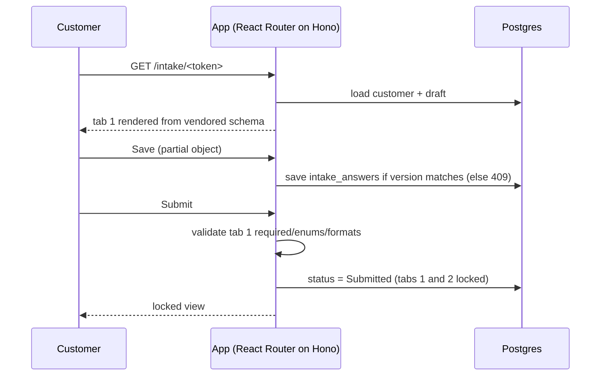

# Design — Screen E tab 1 — Company & service intake generated from the Package Overview schema

> Brain work item: [[wi-maaz20x-004-intake-company-service]] · brain_commit 68881d9cc32a5a2603e01d2b0268bb38038d1f76 · ignyte-project-brain/projects/maaz20x/work-items/wi-maaz20x-004-intake-company-service.md

## Behavior

- Opening the intake link (no login) shows the header (company name, service name from the customer record), a progress bar across the three tabs, Save and Submit.
- Tab 1 renders sections in schema order: Service identification, Service properties (incl. Trust Center, Secure Configuration Guidance, Additional repositories as **object groups**, not rows), Contacts (repeating list, add/remove row), Advisors (repeating), Certified services (repeating), Third-party information resources (certified / non-certified, repeating), labelled with FedRAMP's words "Third-party information resources within the Minimum Assessment Scope" and a one-line note that this is not limited to services that touch federal data (Christina, 2026-10-22; MAS-CSO-TPR). `assessor` is hidden from the customer.
- **UEI number** is an optional question (`serviceIdentification.ueiNumber`, "If no UEI is available leave this blank"); when filled it goes into the file, when empty the key is omitted (Christina, 2026-10-22).
- **Autosave.** Answers save by themselves 2 seconds after the customer stops typing (debounced, same versioned save as Save, status to In progress on the first save); the "Save" button stays and shows "Saved" with the time (Christina, 2026-10-22). After Submit, autosave and Save are refused (the tab is read-only).
- **Save conflicts** (E2, closes pr-9 nit 9 of IGN-8; wi-004 owns this rule and does not wait for [[wi-maaz20x-011-form-engine]]). Save and autosave send tab 1 together with the `version` the page loaded. The server writes only if that version is still current, bumps it and returns the new one. Otherwise it answers 409 with the stored answers and stores nothing; the page shows "This form was changed in another window" with **Keep mine** (save again on top of the stored version) and **Take theirs** (load the stored answers). Typed answers are never overwritten silently (Christina, chat 2026-10-22, row 5). `upsertIntakeSection`, which writes with no version, is removed, not reused.
- **"Why we ask" per question** (Christina, chat 2026-10-22, row 3; decision Jesús 2026-10-23): each tab 1 question shows its customer-facing line from the "Why we ask (client)" column of [[maaz20x-intake-questionnaire]] §2, word for word, when the line exists; the internal column is never shown. Today questions 1–5 have no client line ("—"), so none is shown; Jesús asked Christina for them. Adding them later is a text change in the form definition, not a spec change.
- **Prefill**: provider name, service name and service description start with the values Ignyte typed on Screen C ([[wi-maaz20x-003-customers-list-and-create]]); the customer can change them.
- **FedRAMP 20x class: Class A only, no dropdown.** The MVP onboards Class A customers only (Christina, gate-3 review of tab 2, 2026-10-19: "take class A only approach for the moment, iron out issues and expand"). The customer does not pick a class. When the certification type is 20x, the customer record stores `fedramp_class = "A"`, and Screen D shows "Class A" as read-only text next to the certification type. The field stays on the customer record so Classes B, C and D can be added later without migrating stored customers. This replaces the Class A / B / C / D dropdown from [[maaz20x-feedback-2026-10-14-mockups]] item 1; the mockup still shows the dropdown and must be updated.
- **FedRAMP package ID is optional** for the customer (Max's feedback, item 2), with the explanation "Only if FedRAMP already assigned you one". When empty, the JSON uses provider name + service acronym (for example "Example Cloud Co. ERP"), as the schema itself instructs, and the field shows the customer "Filled in automatically until FedRAMP assigns your ID"; the shown value follows the provider name and acronym as they are typed, and with either one missing no value and no note are shown; once FedRAMP assigns an ID and it is entered, it replaces the fallback (Christina, 2026-10-22, [[maaz20x-chat-2026-10-21-christina-questions]]).
- Required fields are marked from the schema's `required` arrays. Enumerated fields are dropdowns/multi-selects with the exact schema strings.
- **Form labels by schema path.** Tab 1 publishes its question labels keyed by schema path (`*` for list items), including the MAS-CSO-TPR section label; Screen D uses them to name problems ([[wi-maaz20x-007-package-overview-json]] E2).
- **Ignyte-owned fields are never taken from the customer** (E4): the save action drops `serviceIdentification.logo` and `assessor` from what the browser sends.
- **Logo is an upload, not a URL.** The customer uploads the logo file with short instructions (PNG or JPEG, at least 256 px wide, max 2 MB; decision Jesús 2026-10-23: no SVG, since the file is public and an SVG can carry scripts); the app stores it and **hosts it on Ignyte's side**. The hosted URL fills `serviceIdentification.logo` at JSON generation. Preview and "Replace logo" shown after upload. `website` remains a plain URL field.
- Save stores a draft; reopening the link shows saved answers. Submit runs validation, locks tabs 1 and 2 and sets the customer status to Submitted; Ignyte can unlock (Screen D, [[wi-maaz20x-003-customers-list-and-create]]). Tab 3 (documents) stays open after Submit ([[wi-maaz20x-006-intake-documents]], Christina 2026-10-20; decided by Jesús with this default on 2026-10-23, Max not awaited, [[gates]] §3; Escalation Rule if Max decides otherwise).
- Customer status becomes In progress on first save.

## Data and fields

Field list, types and required flags: [[maaz20x-contract-package-overview-json]] §2 (not duplicated here; the form is generated from the same schema file). Storage (E1, as built for [[wi-maaz20x-007-package-overview-json]]; closes pr-9 finding 7 of IGN-8): one `intake_answers` row per customer and tab, `section = 'company'` for tab 1 (`ksis` for tab 2, `documents` for tab 3), a JSON column holding the partial Package Overview object, an integer `version` (E2) and `form_definition_version` (E3). The form definition records the Package Overview schema version and commit it was generated from; the row does not repeat them, and no version literal is written in code (generated files carry their own versions, wi-007). `serviceIdentification.fedRampPackageId`: filled with "<provider name> <service acronym>" when empty (playbook S3-03 and Christina 2026-10-22, see [[wi-maaz20x-007-package-overview-json]]; not a converter convention, the converter has none). `serviceIdentification.logo`: not typed by the customer. The logo is a `documents` row at `customers/<id>/logo/<logo-id>.<ext>` ([[maaz20x-contract-package-overview-json]] §1); the newest row is the current logo; Replace adds a row and keeps the old one. Public URL = `LOGO_PUBLIC_BASE_URL` + the object path, so it ends with the file name (wi-007 F-f); no `/logos/<customer-id>` route and no logo columns on `customers`. Logo rows never appear in tab 3, in Screen D's documents list or in the documents checklist ([[wi-maaz20x-006-intake-documents]]). Only logos are public; every other document stays private.

## Validation

- Client-side (Valibot, generated from the schema): required, string formats (uri, email, date), enum membership.
- `accessRequestInstructions` required when `authenticationRequired` is true (Trust Center, Secure Configuration Guidance, Additional repositories).
- Logo upload: PNG or JPEG, size ≤ 2 MB, min width 256 px, checked client-side and again server-side when the upload finishes: size, content type and file signature (magic bytes); on failure the object is deleted and nothing is recorded. The logo has its own allowlist, separate from the documents tab's. Required for Submit.
- Phone: accept as typed, no format rejection at this tab; the schema pattern (any common US format with area code) is checked by JSON validation on Screen D. The hint shows `202-555-0123` and `(800) 555-0199 ext. 42`.
- Submit blocked while any required field in tab 1 is empty; Save never blocks.
- Contacts: Submit requires at least one contact of type Security and one of type Sales (the schema's `contains` rules on `contactInformation`, CDS-CSO-PUB); the message is built from the schema's `contains` rule and the tab 1 label of `/contactInformation`, like every other message (no hand-written per-field text, [[wi-maaz20x-007-package-overview-json]] D3, E6), and is shown on the Contacts section.

## Permissions

Anyone with a valid, unexpired link can read and write the draft until Submitted (plan §1.4, §4.2). After Submit: read-only for the link, until Ignyte unlocks. Ignyte users: read-only view on Screen D.

**Customer link token** (E5): `/intake/<token>` routes accept only a valid, unexpired token ([[wi-maaz20x-003-customers-list-and-create]] E4); the customer is taken from the token, never from the URL or the body. Save, autosave, Submit and logo-upload requests after expiry, after Issue new link, or (for tabs 1 and 2) after Submit store nothing and answer "expired" or "locked"; the page then shows "This link has expired. Ask your Ignyte consultant for a new one." (expired or replaced) or the read-only view (locked). A staff session grants nothing on `/intake/<token>`; staff routes refuse tokens ([[wi-maaz20x-002-ignyte-login]]).

**Error states.** Save or autosave fails (network or server): "Not saved yet. We will try again." and a retry on the next change or Save; nothing typed is lost from the page. Conflict: see Save conflicts (§3). Upload fails or is refused: the instructions are shown again with the reason (too big, wrong type, too narrow).

## Flows

## Integrations

- [[integration-maaz20x-to-fedramp-schemas-catalog]]: the form reads the vendored pinned schema; no runtime GitHub call.
- [[integration-maaz20x-to-google-cloud-storage-documents]]: the logo upload (signed upload URL, then the finish check above).

## Non-functional requirements

- Form definition derives from the schema file at build time; adding a schema version must not require hand-editing fields.
- Autosave required (Christina, 2026-10-22): debounced save a few seconds after typing stops, plus the explicit Save button.
- Accessibility: labels bound to inputs, keyboard navigable (shadcn defaults); the save state ("Saved", "Not saved yet") is announced in a live region.
- Security: the token is in the URL, so intake pages send `Cache-Control: no-store` and `Referrer-Policy: no-referrer`; the logo is the only public object, PNG or JPEG only, checked by signature after upload.
- Performance: a save writes one row; autosave at most once per 2 seconds per tab.
- Cost: none beyond storage of logos.
