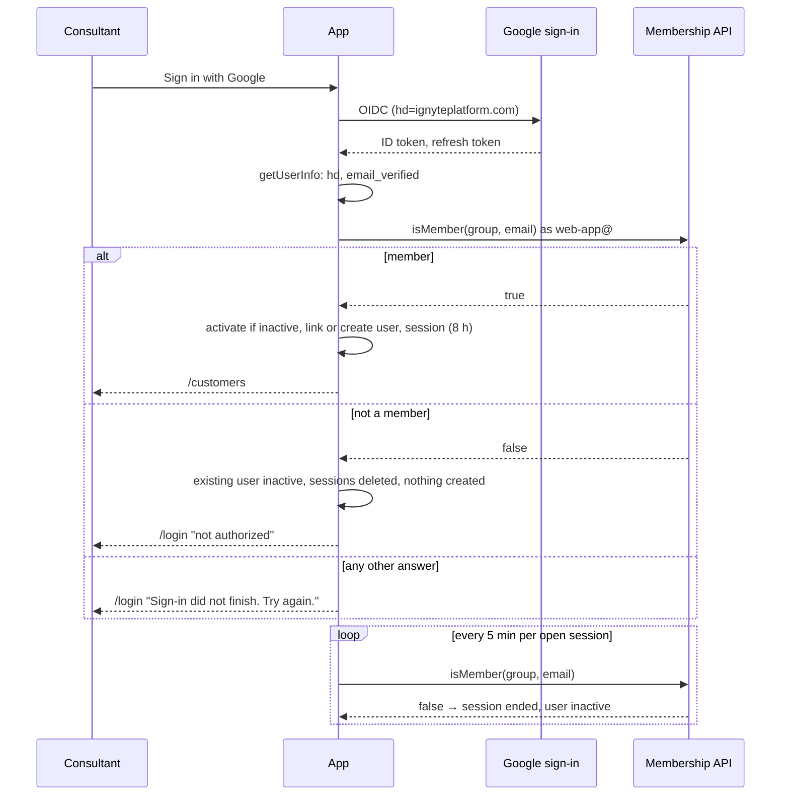

# Design — Staff access through the Google group ignyteFedramp20x instead of the ADMIN_EMAILS allowlist

> Brain work item: [[wi-maaz20x-019-staff-access-google-group]] · brain_commit 23b302964bbd0ef54494f64d12d39787561bb35c · ignyte-project-brain/projects/maaz20x/work-items/wi-maaz20x-019-staff-access-google-group.md

## Behavior

**Sign-in.** wi-002's checks stay: ID token, `hd == ignyteplatform.com`, `email_verified`, refresh token present. The membership check replaces "email present in `users`" and runs in the app's `getUserInfo`, **before Better Auth writes any row**, with the verified, lowercased email:
- Member → if the user exists and is inactive, it is set `active = true` there (before `session.create.before`, which still refuses inactive users); Better Auth then links or creates the user and creates the session; redirect to `/customers` as today.
- Not a member → redirect to `/login?error=not_authorized` ("This account is not authorized for Ignyte FedRAMP 20x"); no user and no account row is written; an existing user is set `active = false` and their sessions deleted.
- Directory unreachable or any non-success answer → redirect with a new error code outside `ACCOUNT_REFUSED`, so the page shows "Sign-in did not finish. Try again."; nothing written. Fail closed.
- `disableSignUp` is removed. A `user.create.before` guard (same style as `assertGoogleRefreshToken`) allows creating a user only on the Google callback path, so no other endpoint can create users.

**Open sessions.** The staff guard keeps its per-request check of `users.active` and the 8-hour cap. Added: every 5 minutes per session (`last_group_check_at` older than 5 minutes), one request re-checks membership, claiming it with one atomic update like the Google re-check (`UPDATE sessions SET last_group_check_at = now() WHERE id = $1 AND last_group_check_at < now() - interval '5 minutes' RETURNING id`). Other requests of the same session skip the call. The request that gets the claim may wait up to the 5-second timeout.
- Member → nothing changes.
- Not a member → user set `active = false`, all their sessions deleted, redirect to `/login` with "not authorized".
- Unreachable or any non-success answer → the claim is given back (next request retries) and the session stays, **but only up to 15 minutes after the last successful group check**; past that the session ends (E3).
- **Effect to accept (E3):** a Google-wide outage usually takes both the token endpoint and the Directory API down, so in practice sessions end after 15 minutes, not after the 60-minute Google-outage cap of wi-002 (decided 2026-10-23). The 60-minute rule stays in the code, but the lived limit becomes 15 minutes. During such an outage nobody can sign in, Jesús included.
- The two re-checks (group every 5 minutes, Google account every 15) are independent: each has its own column, claim and release. When both are due on the same request, the group check runs first.

**Membership driver.** A port `StaffDirectory` with `isMember(email): Promise<"member" | "not_member" | "unreachable">`:
- `google`: Directory API `GET https://admin.googleapis.com/admin/directory/v1/groups/{STAFF_GROUP_EMAIL}/hasMember/{email}` with a token for the runtime service account from Application Default Credentials, scope `https://www.googleapis.com/auth/admin.directory.group.member.readonly`, through `google-auth-library` added as a direct, pinned dependency. `200` with `isMember` true or false gives `member` or `not_member`. **Every other answer (any 4xx, 5xx, timeout) is `unreachable`**; the status and Google's error message are logged, never the token. The email always comes from an `hd`-checked token, so an unknown member is a rare race (account deleted seconds ago), already covered by wi-002's Google re-check.
- **Fallback if the hand test (§8) fails for the Directory API:** the same port with Cloud Identity Groups API `groups.lookup` + `groups.memberships.lookup` (direct members only, not premium), scope `cloud-identity.groups.readonly`, Cloud Identity API enabled. This is the path Google documents for admin-role service accounts. Which driver ships is decided by the hand test, before the `google` driver is written (everything else — the port, the `local` driver, the sign-in and re-check logic, the retirement of the allowlist — does not wait for it); nested groups are then not supported (Adam keeps the group flat).
- `local`: members are `LOCAL_STAFF_EMAILS` (comma-separated, default `DEV_LOGIN_EMAIL`).
- Default: `local` outside production, and production requires `google` (like `STORAGE_DRIVER`). The app refuses to start with `STAFF_DIRECTORY=local` when `NODE_ENV=production`, the same way it refuses `DEV_LOGIN`.
- `DEV_LOGIN`: the plugin creates the session itself, so it calls the same `isMember` (local driver) before `createSession`; refused → "not authorized". The dev user is created by the local fixture seed (`db:seed`) before the customer fixture, instead of the allowlist seed.

**Retired.** `ADMIN_EMAILS` and the allowlist seed, everywhere: env schema and its test (`server/config/env.ts`, `env.test.ts`), `.env.example`, `server/db/seed-allowlist.ts`, `server/db/allowlist.ts` and its test, the allowlist function in `server/repositories/users.ts`, `package.json` (`db:seed:allowlist`, `db:up`), `Dockerfile` CMD (becomes migrate then start), CI step, the Cloud Run service definition (secret entry and header comments), README rows, the `users.active` comment in `server/db/schema/users.ts`, `docs/architecture/folder-structure.md`, the dev-login error text and the smoke and unit tests that name them (`tests/smoke/app.smoke.test.ts`, `tests/smoke/google-callback.smoke.test.ts`, `server/services/session.test.ts`). The OpenSpec change of this item MODIFIES the login spec `openspec/specs/maaz20x-ignyte-login/spec.md` (purpose and the scenarios about the allowlist) and REMOVES the scenario "the seed runs with ADMIN_EMAILS". Existing `users` rows stay; `active` is now written by the membership checks.

**Rollback (E4).** No break-glass account. Rollback is the previous Cloud Run revision, which only works while the `ADMIN_EMAILS` secret exists. Warning: the previous image runs `db:seed:allowlist` at start, which deactivates every user not in `ADMIN_EMAILS` (on dev today only Jesús) and deletes their sessions. Before rolling back, set `ADMIN_EMAILS` to the current group members. Rolling forward again reactivates members at their next sign-in. If the Groups Reader role is revoked by mistake, nobody can sign in until Adam or Max assigns it again: written in the runbook's incident section.

## Data and fields

- `sessions.last_group_check_at` (timestamp with time zone, not null, default now()): new column, a Better Auth `session.additionalFields` entry next to `last_google_check_at`, wired in `resolveStaffUser` like `lastGoogleCheckAt`. Migration required; the old code ignores it, so it does not block a rollback.
- `users`: unchanged; `active` keeps its meaning (may pass the staff guard) and is written by the membership checks. New users get `active` true from the existing default and `name` from the Google profile.
- Configuration:
  - `STAFF_GROUP_EMAIL`: the group's email, plain env var (not secret), lowercase. Required in production. Value from Adam's answer; the expected value is `ignytefedramp20x@ignyteplatform.com`, set only in the Cloud Run service definition.
  - `STAFF_DIRECTORY`: `google` or `local` (default `local` outside production).
  - `LOCAL_STAFF_EMAILS`: only for the `local` driver.

## Validation

- `STAFF_GROUP_EMAIL` must end in `@` + `GOOGLE_ALLOWED_DOMAIN`; the app refuses to start otherwise, and in production when it is empty. If Adam's answer puts the group on another domain, this rule is changed at handoff (clarification).
- `STAFF_DIRECTORY=local` with `NODE_ENV=production` → the app refuses to start.
- The email sent to the membership API is the verified, lowercased email from the ID token, URL-encoded in the path.
- Error states as in wi-002 §5: a failed membership check is "not authorized"; a membership API failure at sign-in is "Sign-in did not finish. Try again."

## Permissions

- One implicit role, as in wi-002: every group member who passes the checks is an Ignyte consultant with full access.
- The runtime service account `web-app@ignyte-maaz20x-dev.iam.gserviceaccount.com` holds the Workspace admin role **Groups Reader** (assigned by Adam): it can read groups and membership only, not change groups or users. No domain-wide delegation, no key file.
- Who is in the group: Max and Adam (Tanner as last resort), in the Google Admin console or Google Groups. Leaver checklist: suspend or delete the Workspace account, and remove the person from the group; no redeploy.

## Flows

## Integrations

- Google Admin SDK Directory API (`admin.googleapis.com`), or the Cloud Identity Groups API if the fallback is chosen, called from Cloud Run with the runtime service account's token. No new integration note: it is part of the Google Workspace dependency recorded in [[adr-0004-maaz20x-google-workspace-login]] (amended).
- **Before the `google` driver is written and before the dev deploy (E6, Jesús, pass condition):**
  1. Adam: Groups Reader to `web-app@ignyte-maaz20x-dev.iam.gserviceaccount.com`, and the group's exact email (asked 2026-10-28).
  2. Jesús: enable the Admin SDK API in `ignyte-maaz20x-dev` (`gcloud services enable admin.googleapis.com`, `ignyte` configuration).
  3. Jesús: hand test. Mint a token for `web-app@` with scope `admin.directory.group.member.readonly` (impersonating the service account) and call `hasMember` for a member and a non-member. Pass: `200` with `isMember: true` and `200` with `isMember: false`. Fail: try the fallback the same way (enable the Cloud Identity API, `memberships.lookup`) and record which driver ships in History before handoff.
- **After the merge, before deleting anything (Jesús):** deploy to dev; sign in with a group member; check that a non-member is refused (§9 [pre-prod]); update the runbook [[maaz20x-runbook-gcp-dev-console]] (Groups Reader on `web-app@`, the API, the incident note of §3 Rollback); then delete the `ADMIN_EMAILS` secret and its accessor binding.
- The code is built and tested with the `local` driver and a stubbed membership API; the dev deploy waits for 1–3 (otherwise nobody can sign in on dev: fail closed).

## Non-functional requirements

- At most one membership call per session every 5 minutes, plus one per sign-in; 5-second timeout. Far below the API quota.
- The access token is cached and refreshed by `google-auth-library`; it is never logged.
- No user email in error logs beyond what wi-002 already logs; configuration errors log the group email, the HTTP status and Google's error message (so a missing role and a missing scope, both 403, can be told apart).
