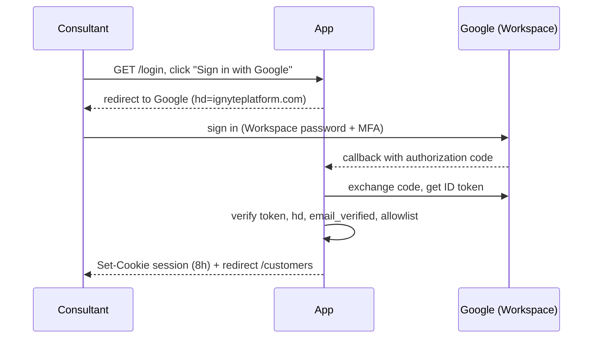

# Design — Screen A — Ignyte login (Sign in with Google, Ignyte Workspace accounts)

> Brain work item: [[wi-maaz20x-002-ignyte-login]] · brain_commit 537ea5b73a3b21864c7e8405999642a11046b09f · ignyte-project-brain/projects/maaz20x/work-items/wi-maaz20x-002-ignyte-login.md

## Behavior

- `/login` shows one button, "Sign in with Google". It starts the OpenID Connect flow with the `hd=ignyteplatform.com` hint.
- On callback the server verifies the ID token, then requires `hd == ignyteplatform.com`, `email_verified == true` and the email present in `users`. If all pass → session and redirect to `/customers` (Screen B). Otherwise → `/login` with "This account is not authorized for Maaz 20x" (no detail on which check failed).
- Session cookie, 8-hour lifetime, **fixed: never extended by activity** (E2: Better Auth `session.disableSessionRefresh: true`; with the default `updateAge` an active session would never end). `/logout` deletes the session and returns to `/login`.
- **One staff guard** (E1, closes pr-9 finding 7 of IGN-8): every Ignyte loader and action (home, Screen B, C, D, the JSON download, every later staff route) calls the same `requireStaffUser`. It reads the session from the database, never from the cookie cache (E2; [[adr-0005-maaz20x-caching-strategy]] to be amended: one indexed read per staff request), joins `users`, and refuses unless the user is `active`. The dev-only `DEV_LOGIN` path goes through the same check and refuses inactive users. Today's guard accepts any session; the code changes with this item.
- Every Ignyte route requires a session; unauthenticated requests redirect to `/login`. Intake links (`/intake/<token>`) never require a session.
- **Open sessions are re-checked** (Jesús's proposal, 2026-10-22, answering Christina's review of brief 02, which asked how a leaver's open session is cut short; the engineer review decides):
  - On every Ignyte request the session's user is looked up in `users` and must be `active`. A user taken off the allowlist is rejected on the next request (session deleted, redirect to `/login`); taking someone off the list also deletes all their sessions at once.
  - Every 15 minutes per session (`last_google_check_at` older than 15 min) the server refreshes the Google access token with the stored refresh token (E3). The guard calls Google's token endpoint (`https://oauth2.googleapis.com/token`) itself, because the library's refresh endpoint reports every failure the same way. HTTP 400 with `error=invalid_grant` (account deleted or suspended, consent revoked) ends the session. A network error or a 5xx is "Google unreachable": the check is retried on the next request and the session stays, **but only up to 60 minutes after the last successful check**; past that the session is ended (decision Jesús 2026-10-23: a Google outage does not stretch a leaver's access to 8 h).
  - Only one request per session calls Google: the guard claims the check with one atomic update (`UPDATE sessions SET last_google_check_at = now() WHERE id = $1 AND last_google_check_at < now() - interval '15 minutes' RETURNING id`); requests that do not get the row skip the call.
  - Google only returns a refresh token on consent, so the sign-in asks for offline access with `prompt=consent select_account` (one extra click on an Internal app). A sign-in that ends without a refresh token is refused with the same "not authorized" message. OAuth tokens are stored encrypted (Better Auth `account.encryptOAuthTokens: true`).
  - Verification with a suspended test account is **not** part of gate 3 (no OAuth client exists yet, E4): it is a pre-production task, owner Jesús, needing a Workspace super-admin to create and suspend a test user. The leaver checklist says *suspend or delete* the Workspace account (a password reset alone may not revoke the grant).
- The allowlist is seeded at deploy from `ADMIN_EMAILS` (comma-separated, from the environment, never in the repo) by an **allowlist seed separate from the local fixture seed** (E5); production runs only the allowlist seed. It fails on any email outside `@ignyteplatform.com` and, in production, on an empty `ADMIN_EMAILS` (a bad deploy must not lock everyone out); outside production the `DEV_LOGIN_EMAIL` user is exempt. Re-running the seed with an email removed sets that user `active = false` and deletes their sessions in the same transaction; the row is kept (history of who created what). First-day allowlist: Max and Jesús. Taking a leaver off `ADMIN_EMAILS` and redeploying is part of the leaver checklist, done the same day the Workspace account is closed.

## Data and fields

`users`: id, email (unique, lowercase), name, active (boolean, not null, default true), created_at, last_login_at. (The Google subject is Better Auth's `accounts.account_id`; no separate `google_sub`.) Migration adds `users.active`, `users.last_login_at` and `sessions.last_google_check_at` (a Better Auth `additionalFields` entry). No password column. Better Auth owns the session and account tables; the account row holds the Google refresh token (server-side only), and the session row gets `last_google_check_at` for the 15-minute re-check.

## Validation

- ID token signature, audience and expiry verified by the library.
- `hd` and `email_verified` checked server-side; the `hd` login hint is never trusted on its own.
- Emails in `ADMIN_EMAILS` must end in `@ignyteplatform.com`; the seed fails otherwise.

**Error states.** Every sign-in failure returns to `/login` with the one message "This account is not authorized for Maaz 20x" when the account fails a check (`hd`, `email_verified`, allowlist, inactive, no refresh token). Cancelled at Google, an OAuth error, or Google unreachable at sign-in show "Sign-in did not finish. Try again." and create no session. The code's two current messages (not an Ignyte account / not on the staff list) collapse into the first one.

## Permissions

One role implicitly: any signed-in, allowlisted user is an Ignyte consultant with full access. Roles are out of scope (plan §4.1).

## Flows

## Integrations

Google Identity (OpenID Connect) through an OAuth client in the Maaz 20x GCP project, consent screen type Internal. Scopes `openid email profile`, with offline access (`access_type=offline`) so a refresh token exists for the 15-minute account re-check. Depends on GCP project access ([[maaz20x-architecture-workstream]] §4–§5): the OAuth client and the Internal consent screen live in the Maaz 20x GCP project inside the ignyteplatform.com organization, created under jesus.p@ignyteplatform.com (E7). Which project (`maaz20x-dev` or `ignyte-services`) is Tanner's answer, still pending; moving later means a new client ID and secret, harmless with 8-hour sessions. Until then the Google criteria below are verified before production only; the code is built and tested with `DEV_LOGIN` and a stubbed token endpoint.

## Non-functional requirements

- Security: HTTPS only; OAuth client secret in Secret Manager; no passwords stored anywhere; OAuth tokens encrypted at rest.
- Performance: one indexed database read per staff request (session + user), and at most one call to Google per session every 15 minutes, off the cookie cache.
- Accessibility: the login page is one labelled button and one message in a live region; keyboard reachable.
- Cost: none beyond the Workspace test account for E4.
